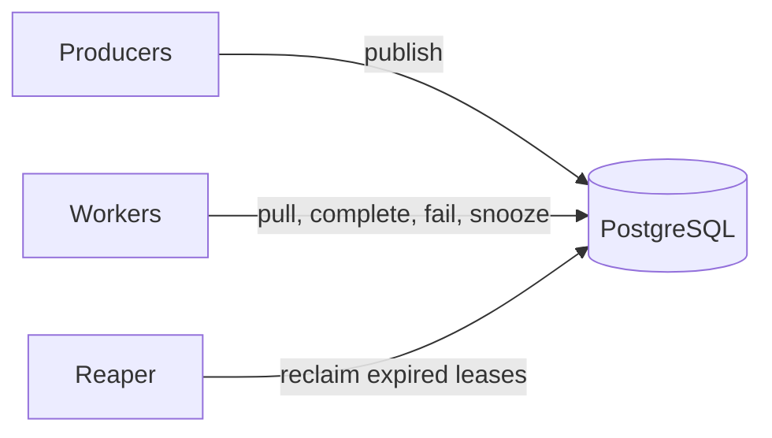

# How it works

This page explains the moving parts. Reading it makes the rest of the
documentation, and the library's behaviour under failure, much easier to
predict.

## Everything is a row

The queue is four tables in PostgreSQL:

| Table                | Holds                                                                |
| -------------------- | -------------------------------------------------------------------- |
| `queues`             | One row per queue, with its configuration                            |
| `jobs`               | One row per **live** job. Completed and failed jobs are deleted.     |
| `queue_shards`       | Slot counters that enforce a queue's `concurrency` cap               |
| `group_queue_limits` | Slot counters that enforce per-group caps                            |

Processes keep no state that matters between calls, apart from a cache of
queue configuration. Any number of producers, workers and reapers, on any
number of machines, coordinate through row locks in these tables. The
[Database schema](../reference/database-schema.md) reference lists every
column.

## Three roles



- **Producers** call `publishJob` or `publishJobs`. A producer is usually
  your web application. A publish is one `INSERT`, and it can be part of a
  transaction you already have open.
- **Workers** pull jobs and run your handler. `WorkerService` is the built-in
  worker loop.
- **The reaper** finds jobs whose worker disappeared and puts them back in the
  queue. `ReaperService` runs it on a timer. At least one must run somewhere.

## Pulling a job: the lease

A pull is a single statement. It picks the oldest due `PENDING` job of the
queue with `FOR UPDATE SKIP LOCKED`, so concurrent workers never wait for each
other and never get the same job. It then marks the job `PROCESSING` and gives
it a lease:

```text
lease_expires_at = now() + leaseDuration
```

The lease is the worker's promise to report back before that time. If it does
not, the reaper assumes the worker died and makes the job available again.

## Settling a job: the fence token

Every pull also increments the job's lease sequence number and returns it to
the worker as `job.lockSeq`. Recording an outcome (completing, failing or
snoozing the job, collectively called *settling* it) requires that number. The
settle is only accepted if the number matches the current lease and the job is
still `PROCESSING`.

This protects against a worker that lost its lease without knowing it: a long
garbage-collection pause, a network partition, a handler that ran past the
lease. By the time it reports back, the reaper may have handed the job to
another worker, which holds a newer `lockSeq`. The old worker's settle is
rejected with `LeaseLostError`, so it cannot overwrite the new owner's outcome.

Fencing keeps outcomes consistent. It does not stop two workers from *running*
the same job at once in that window. That is why delivery is
[at least once](job-lifecycle.md#delivery-guarantees).

## Settled jobs are deleted

Completing a job deletes its row. So does failing it when no attempts are left.
There is no history table and no dead-letter queue. Deleting the row also
frees its idempotency key, so the same key can be published again later.

## Two execution paths

Each queue uses one of two sets of SQL statements, chosen from its
configuration:

- **Fast path:** `concurrency: 0` and `requiresGroupId: false`. Pull, complete
  and fail touch only the `jobs` table. Nothing is capped, and group caps are
  ignored.
- **Coordination path:** `concurrency > 0` or `requiresGroupId: true`. A pull
  also takes a slot from the queue's shard counters and, for a job in a group,
  from that group's counter. Settling the job gives the slots back.

Each operation is still one statement on both paths, with one round trip and
no explicit transaction. You do not pick the path directly; it follows from the
queue's settings. [Concurrency control](concurrency-control.md) explains the
caps.

## Polling

Workers poll. A worker slot that finds no due job waits `pollInterval`
(default 1 second) and asks again. There is no `LISTEN/NOTIFY`, so on an idle
queue a new job waits up to one poll interval before a worker picks it up.

## Time comes from the database

Leases, delays and snoozes are computed with the database server's clock
(`now()`), not the application's. Clock differences between your servers do
not affect when jobs become due or when leases expire.
