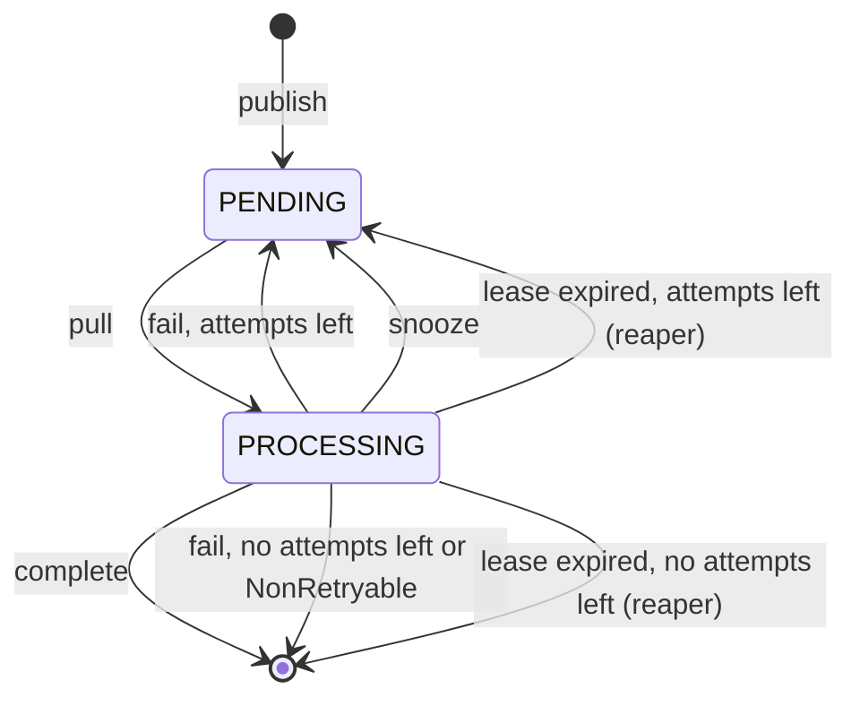

# Job lifecycle

## States

A live job is either `PENDING` (waiting to be pulled) or `PROCESSING` (leased
by a worker). There is no completed or failed row: those jobs are deleted.
`COMPLETED` and `FAILED` only appear on the object a settle call returns.



Arrows into `[*]` mean the row is deleted.

## When a job is due

Every job has an `availableAt` time. A pull only considers `PENDING` jobs
whose `availableAt` has passed, and takes the oldest one.

| Event                        | `availableAt` becomes                    |
| ---------------------------- | ---------------------------------------- |
| Publish                      | time of the publish, plus `delayMs`      |
| Snooze                       | now, plus the snooze delay               |
| Fail with attempts left      | unchanged: due at once                   |
| Lease expired, reset by the reaper | unchanged: due at once             |

A failed or reclaimed job keeps its original `availableAt`, so it goes back to
the front of the line, ahead of jobs published after it.

## Attempts

The queue's `maxAttempts` is the number of times a job may be leased before the
library gives up on it.

- Every pull adds one to `job.attempts`. Inside a handler, `job.attempts` is
  `1` on the first run, `2` on the second, and so on.
- A lease that expires counts the same as a failure.
- Snoozing refunds the attempt, so snoozing never uses up the budget.

| Outcome           | Triggered by (with `WorkerService`)    | Attempt spent? | What happens next |
| ----------------- | -------------------------------------- | -------------- | ----------------- |
| Complete          | the handler returns                    | n/a            | Deleted |
| Fail              | the handler throws an ordinary error   | Yes            | `PENDING` and due at once if `attempts < maxAttempts`, otherwise deleted |
| Fail for good     | the handler throws `NonRetryable`, or the payload is not valid JSON (the handler is not called) | Yes | Deleted, whatever attempts remain |
| Snooze            | the handler throws `JobSnooze(ms)`     | No (refunded)  | `PENDING`, due after `ms` |
| Lease expired     | the worker died, or the handler ran past the lease | Yes | The reaper resets it to `PENDING` (due at once) if `attempts < maxAttempts`, otherwise deletes it |

### There is no backoff between attempts

A failed job is due again immediately and keeps its place at the front of the
line, so it is usually picked up again within milliseconds. A job that fails
because something needs time to recover, such as a rate limit or a downstream
outage, can burn its whole budget almost at once.

For "try again later", throw `JobSnooze` with a delay. Snoozes do not count as
attempts, so a job that always snoozes never gives up. Bound it yourself; see
[Snooze](../guides/workers.md#snooze-try-again-later).

## Ordering

Jobs are handed out by `availableAt`, oldest first. For jobs published without
a delay, that is publish order. It is not strict FIFO:

- With several worker slots, jobs run in parallel and finish in any order.
- A failed or reclaimed job goes back to the front, ahead of newer jobs.
- Jobs published together in one `publishJobs` call share one `availableAt`
  and come out in no particular order relative to each other.
- A delayed or snoozed job takes its place in line when it becomes due,
  behind jobs that were due before it.

If you need strict ordering, give the queue `concurrency: 1`, so that only one
job runs at a time across all workers, and publish jobs one at a time. A failed
job then stays at the head of the line until it succeeds or is discarded.
Snoozing a job still moves it behind the jobs that became due before it.

## Delivery guarantees

**Publishing:** at most one live job exists per `(queue, idempotencyKey)`.
Inside a transaction, the job commits together with your writes or not at all.

**Running:** at least once. A job can run more than once when:

1. **The worker crashed** after the handler started but before the outcome was
   recorded. The lease expires, the reaper resets the job, and another worker
   runs it.
2. **The handler ran longer than `leaseDuration`.** The reaper reclaims the job
   while the first handler is still running, and another worker can start it.
   The first worker's settle is later rejected with `LeaseLostError`, but its
   side effects have already happened.
3. **The worker could not record the outcome** before its settle-retry deadline,
   for example during a database outage. The job stays `PROCESSING` until its
   lease expires, and then the reaper hands it out again.
4. **The handler failed.** Retrying is the intended behaviour.

So handlers must be safe to run twice. Common ways to get there:

- Pass `job.idempotencyKey` to downstream APIs that accept an idempotency key.
- When the side effect is a write to your own database, make it conditional:
  a unique constraint on the job's key, or an upsert, inside the handler's
  transaction.
- Check whether the work was already done before doing it.

`job.id` is stable across the retries of one job. `idempotencyKey` is too, and
is the better choice for downstream deduplication, because it names the
business operation rather than the database row.

## No history

Completed and discarded jobs are deleted. After that, `getJob(id)` throws
`JobNotFoundError`, and nothing records that the job failed. If you need a
record of jobs that failed for good, write it yourself before the last attempt
ends:

```ts
const MAX_ATTEMPTS = 3; // the queue's maxAttempts

const worker = new WorkerService(jobService, {
  queueId: queue.id,
  handler: async (job, payload) => {
    try {
      await doWork(payload);
    } catch (err) {
      if (job.attempts >= MAX_ATTEMPTS) {
        await recordDeadJob(job, err); // your own table, log or alert
      }
      throw err;
    }
  },
});
```

This does not catch the case where the last attempt ends with an expired lease
instead of an error: the reaper deletes such jobs without reporting them.
